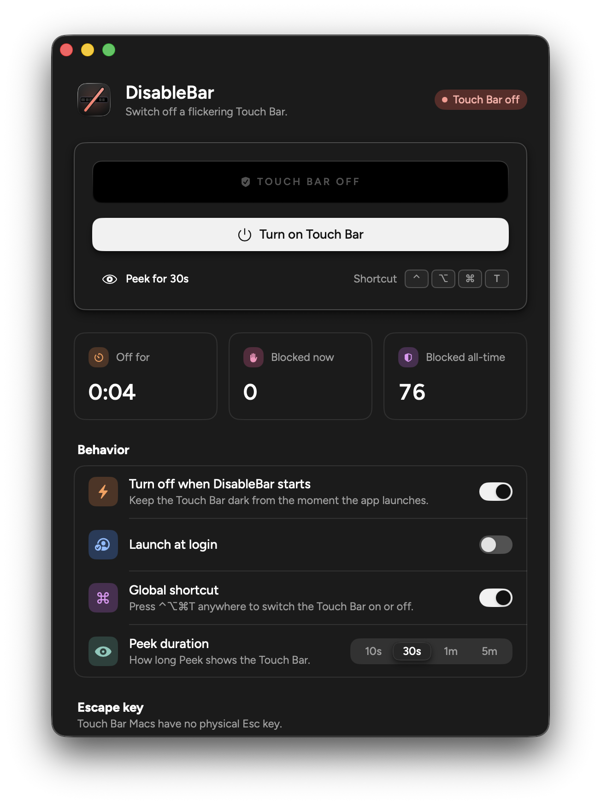
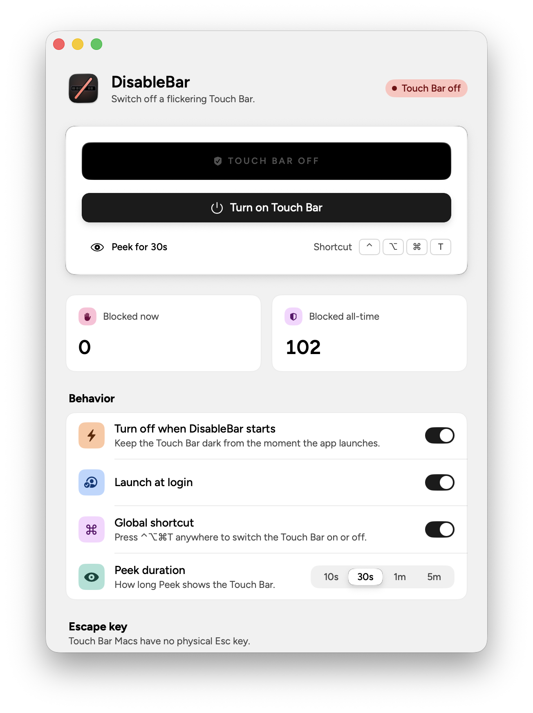
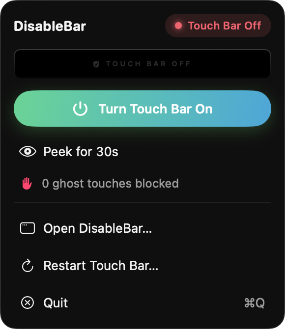

<div align="center">



# DisableBar

**Turn off a flickering MacBook Pro Touch Bar with one click, and stop ghost touches from pressing buttons.**

[](#requirements)
[](#build-from-source)
[](#requirements)
[](#install)
[](LICENSE)

[Download](../../releases/latest) · [Install](#install) · [Features](#features) · [How it works](#how-it-works) · [FAQ](#faq)

</div>

---

Many Touch Bar MacBook Pros develop a **flickering, glitching or “ghost touching” Touch Bar**: the strip flashes, and phantom touches change the volume or brightness, or trigger Siri on their own. macOS has no setting to switch it off.

DisableBar adds a switch for it. It lives in your menu bar, needs no admin rights, doesn't modify macOS, and quitting it brings your Touch Bar back.

## Features

| | |
|---|---|
| ⏻ **One-click on/off** | Black out the whole Touch Bar (Esc and Control Strip included) from the menu bar or the main window. |
| ✋ **Ghost-touch shield** | While off, every touch is absorbed, so phantom touches can't press anything. A counter shows how many were blocked. |
| ⌨️ **Global shortcut** | Press <kbd>⌃</kbd> <kbd>⌥</kbd> <kbd>⌘</kbd> <kbd>T</kbd> anywhere to toggle. |
| 👀 **Peek** | Need the Touch Bar for a moment? Peek shows it for 10 s – 5 min, then switches it off again. |
| ⎋ **Escape-key rescue** | Touch Bar Macs have no physical Esc key. Map **Caps Lock → Esc** (no permissions needed), or keep a dim, tappable `esc` on the bar. |
| 🚀 **Launch at login** | Optionally start with your Mac and switch the bar off immediately. |
| 🎛 **Layout switcher** | When the bar is on, choose *App Controls*, *Control Strip* or *F1–F12 keys*. |
| 🛠 **Restart Touch Bar** | One-click restart of `TouchBarServer` + `ControlStrip`, the usual fix for a frozen bar. It also detects and un-freezes a suspended Control Strip. |
| 🔁 **Self-healing** | Re-applies the blackout after sleep, wake, screen lock, or if macOS restarts the Touch Bar service. |
| ⬆️ **Auto-updates** | Signed updates via [Sparkle](https://sparkle-project.org). Turn them off in the app if you prefer. |

## Screenshots

<table>
  <tr>
    <td align="center" width="50%"><br><sub>Dark mode</sub></td>
    <td align="center" width="50%"><br><sub>Light mode</sub></td>
  </tr>
  <tr>
    <td align="center" colspan="2"><br><sub>Menu bar popover</sub></td>
  </tr>
</table>

## Design

The interface follows Meta's open-source [**Astryx**](https://github.com/meta/astryx) design system (Neutral theme), ported to SwiftUI in [`src/DisableBar/Design`](src/DisableBar/Design):

* **Tokens:** Neutral's light and dark semantic colors, hue ramps, 4-pt spacing ladder, radii (6 / 10 / 12), control heights (28 / 32 / 36), 14-pt / 1.2 type scale, layered shadows with the dark-mode rim bezel, and its 125 / 300 ms motion curve.
* **Components:** Button (primary, secondary, ghost, destructive), Switch, Card, Section, Item, Badge, Banner, SegmentedControl and Kbd, built to Astryx's specs.
* **Type:** Set in [Figtree](https://github.com/erikdkennedy/figtree), the Neutral theme's typeface, bundled under the SIL Open Font License.

## Install

**Homebrew**

```sh
brew tap ri4dh/tap
brew trust ri4dh/tap        # Homebrew 7+ asks you to trust third-party taps once
brew install --cask disablebar
```

**Download**

1. Download **`DisableBar-<version>.dmg`** from the [latest release](../../releases/latest).
2. Open it and drag **DisableBar** into **Applications**.
3. Launch it. A short setup offers to make Caps Lock act as Esc and to start at login. After that, the app lives in your menu bar.

DisableBar is signed with a Developer ID and notarized by Apple, so it opens without Gatekeeper warnings. It updates itself, too.

### Privacy

DisableBar collects no data and has no analytics. The only network request it makes is the update check against this repository's [appcast](../../releases/latest/download/appcast.xml), which you can switch off in the app.

### Build from source

Requires Xcode 15+ (or the Swift 5.10+ toolchain).

```sh
git clone https://github.com/Ri4dH/disablebar.git
cd disablebar
./scripts/build-app.sh            # → build/DisableBar.app (universal)
./scripts/build-app.sh --install  # also copies it to /Applications
```

The script signs with your Developer ID certificate if one is in your keychain, and ad-hoc otherwise.

<details>
<summary><b>Releasing (maintainers)</b></summary>

```sh
VERSION=1.2.0 ./scripts/build-app.sh --release
```

This builds and signs the app with the hardened runtime, notarizes and staples both the app and `DisableBar-<version>.dmg`, and writes a Sparkle `appcast.xml` signed with the EdDSA key from the keychain. Attach the `.dmg`, `DisableBar-<version>.zip` and `appcast.xml` to a GitHub release tagged `v<version>`, then bump the version and `sha256` in [Ri4dH/homebrew-tap](https://github.com/Ri4dH/homebrew-tap).

</details>

## How it works

The Touch Bar on every MacBook Pro is an **OLED** panel, so a black pixel emits no light. DisableBar uses the same private AppKit API that apps like MTMR and Pock rely on (`+[NSTouchBar presentSystemModalTouchBar:placement:systemTrayItemIdentifier:]`) to put a full-width, pure-black Touch Bar above every app and the Control Strip.

* **Visually off.** The panel shows nothing.
* **Touches go nowhere.** All input lands on a blank view, so ghost touches can't reach the volume slider, Siri or app buttons.
* **Nothing is changed on disk.** No system files, launch daemons or SIP changes. Quit the app (or toggle it on) and the normal Touch Bar comes back.

<details>
<summary><b>Why not just kill <code>TouchBarServer</code>?</b></summary>

That was the first thing tested, on a MacBook Pro (13", M1, 2020) with macOS 26:

| Approach | Result |
|---|---|
| `sudo pkill TouchBarServer` | launchd relaunches it instantly; the bar comes straight back. |
| `sudo launchctl bootout system/com.apple.touchbarserver` | `Operation not permitted while System Integrity Protection is engaged`. |
| `DFRSetStatus` / `DFRSetDimmingStep` (DFRFoundation) | No visible effect from a normal app. |
| **Full-width black system-modal Touch Bar** | ✅ Bar goes dark and touches are absorbed, without root. |

</details>

## FAQ

**Is the Touch Bar really off, or just black?**
It's showing pure black on an OLED panel, so the pixels are unlit. The touch digitizer stays powered, but every touch goes to DisableBar, which ignores it and counts it.

**Does it survive sleep, lock screen, or a Touch Bar crash?**
Yes. DisableBar re-applies itself on wake and unlock, and it watches `TouchBarServer` for restarts.

**What about Touch ID?**
Touch ID is a separate sensor and keeps working.

**How do I press Esc?**
Turn on **Caps Lock acts as Esc** in the app. It uses `hidutil`, keeps any key mappings you already have, and needs no permissions. You can also enable the dim on-bar `esc` key, which needs Accessibility permission to send the keystroke.

**How do I uninstall?**
Run `brew uninstall --cask disablebar`, or quit DisableBar from the menu bar and delete it from Applications. If you enabled Caps Lock → Esc, turn it off first, or log out / restart to clear it.

## Requirements

* A MacBook Pro with a Touch Bar (2016–2022), Apple Silicon or Intel
* macOS 13 Ventura or later (tested on macOS 26)

## Project layout

```
src/DisableBar/          SwiftUI app: state, menu bar, windows, hotkey, helpers
src/DisableBar/Design/   Astryx tokens + components ported to SwiftUI
src/TouchBarPrivate/     Objective-C shim around the private Touch Bar API
assets/fonts/            Figtree (SIL OFL 1.1)
scripts/build-app.sh     Builds, icons, signs and zips DisableBar.app
scripts/make-icon.swift  Renders the app icon
docs/assets/             README artwork
```

## License

[MIT](LICENSE). Design tokens adapted from [Astryx](https://github.com/meta/astryx) (MIT, © Meta Platforms, Inc.). Figtree is licensed under the [SIL OFL 1.1](assets/fonts/figtree.LICENSE.txt). DisableBar isn't affiliated with Apple or Meta. “Touch Bar” and “MacBook Pro” are trademarks of Apple Inc.
